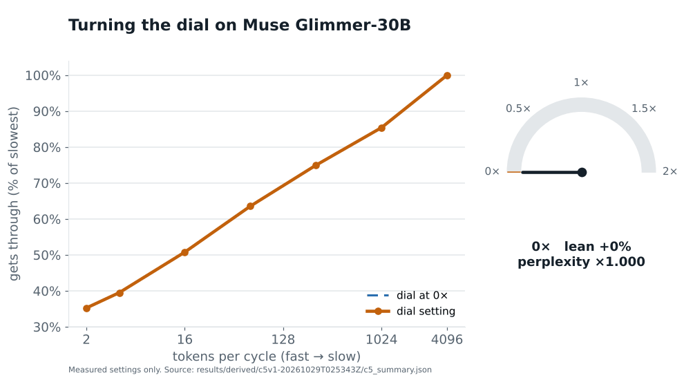
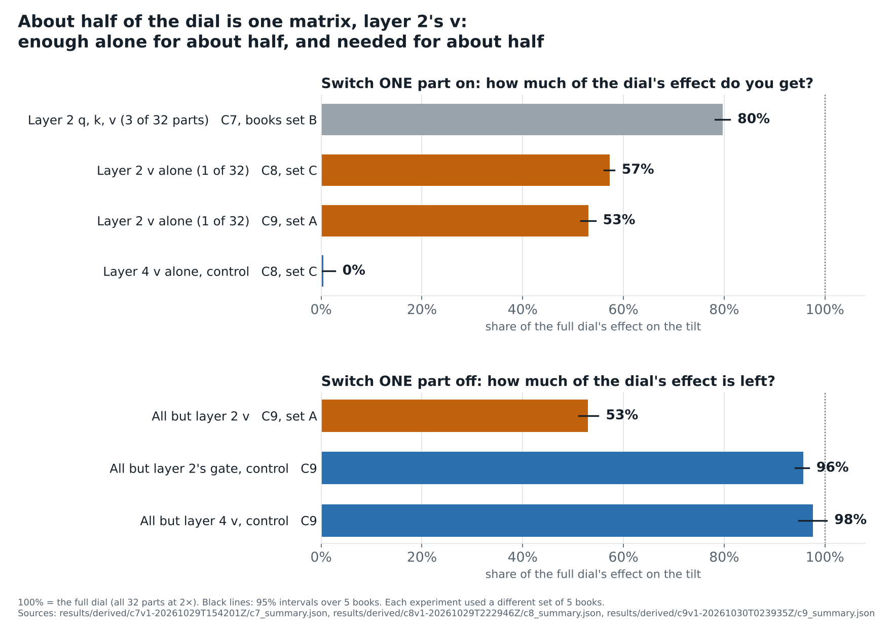
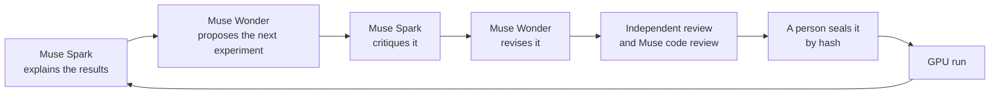

# Dialed In
**Video (3 min):** https://www.youtube.com/watch?v=oRr43YZUMCE

**We played test tones through a language model, found it lets slow ones through more strongly than fast ones, built a knob that turns that down, and traced about half of the knob to a single matrix. Meta's Muse models proposed and reviewed the experiments that found it.**

Building on spectral analysis and model-steering research, Dialed In measures how a pretrained language model, Muse Glimmer-30B, responds to small controlled waves injected into its internal signal, trains a one-knob adapter that reduces the measured slope of that response by 24%, and finds that a single matrix carries about half of the change.

Entry for the Meta Global AI Developer Hackathon, Theme 2: Push the Frontier. Subject model: [Muse Glimmer-30B](https://huggingface.co/meta-models/Muse-Glimmer-30B). Lab scientist: Muse Spark and Muse Wonder on the Meta Model API.

> **See the demo:** open it at [keewillidevnet.github.io/dialed-in](https://keewillidevnet.github.io/dialed-in/), or clone or download this repo and double-click [`demo/index.html`](demo/index.html) to open it in your browser (from a terminal in the repo folder: `open demo/index.html` on a Mac, `start demo\index.html` on Windows). No GPU, no server. The slider steps through the five dial settings we measured (0× to 2×); nothing runs live.

---

## The 30-second version

Audio engineers test a speaker by playing tones through it, from deep bass to high treble, and measuring how loud each one comes out. A perfect speaker plays them all equally. Most don't. We asked whether a language model has a response of the same kind that can be measured directly, and whether it can be turned with a knob.

1. **Measures.** We add a faint wave to the model's internal signal, repeating every 2 to 4,096 tokens, and read how strongly each of its 1,600 instrumented attention heads carries it (458 clear our noise-floor criteria). Slow waves get through much more strongly: the fastest keeps about a third of the slowest's strength, on all 15 books tested. We call the slope of that curve the **lean**. Its direction matches the low-pass theory below; what's new is measuring it head by head with a controlled input.
2. **Controls.** None of the built-in settings we tested met our pre-registered criteria for reducing the lean at an acceptable perplexity cost, so we trained a small adapter with one **dial**. At 2× the lean drops by 24% for a 0.8% rise in perplexity, a standard measure of how well the model predicts text.
3. **Dissects.** Switching the adapter's 32 parts on and off showed that one matrix, layer 2's v, is enough alone for about half of the dial and needed for about half.
4. **Runs as a lab.** Muse Spark explains results and critiques designs, Muse Wonder proposes experiments and reviews code, and a person seals each design by hash before the GPU runs it. The two experiments that found the matrix were Muse's proposals.



---

## What we found, one experiment at a time

Every experiment below was written down in full, with its pass/fail bar, and **sealed by hash before it ran** ([`criteria/SEALS.txt`](criteria/SEALS.txt)). The run code refuses to start if the sealed file or the code changes. Misses are reported as misses.

| # | Question | Answer | Outcome |
|---|---|---|---|
| C1 | Does the model have a frequency response at all? | Yes. Gain rises with the wave's period in all 3 sets of 5 books; the fastest wave keeps 34 to 35% of the slowest. | T (a tilt) |
| C2, C3 | Can the model's own settings turn the lean down (layer gains, chosen heads)? | Not by enough to meet the bar. | K0, K0 (no knob) |
| C4 | What about the attention window size or the position encoding? Is the lean just the text? | Neither moved it enough to count. Shuffling the words keeps 97% of the lean, so it belongs to the model, not the prose (a pass). | D0, D0, A |
| C5 | Can a trained dial turn it down? | Yes, by 24% at 2×, in order at every step and in all 5 books, for perplexity ×1.008. The bar we set was 25%, so this is recorded as a miss. | L0 (near miss) |
| C6 | Does the dial change behavior? | Barely. Prediction right after a switch between books gets 1.8% harder. Too small for the 5% bar. | B0 |
| C7 | Where does the dial act? | Layer 2's q, k and v (3 of the dial's 32 parts) carry 80% of its effect. | M1 |
| C8 | Is it one matrix? *(proposed by Muse Wonder)* | Layer 2's v alone gives 57% of the effect; the same matrix in layer 4 gives 0%. | O1 |
| C9 | Is that matrix needed? *(proposed by Muse Wonder)* | Without it, the full dial keeps only 53% of its effect. Without either control, layer 2's output gate or layer 4's v, it keeps 96 to 98%. | N1 |



Each row traces to a summary file: [C1](results/derived/c1v5-20261027T152040Z/c1_summary.json), [C2](results/derived/c2v1-20261027T201901Z/c2_summary.json), [C3](results/derived/c3v1-20261028T014250Z/c3_summary.json), [C4](results/derived/c4v1-20261028T065820Z/c4_summary.json), [C5](results/derived/c5v1-20261029T025343Z/c5_summary.json), [C6](results/derived/c6v2-20261029T060851Z/c6_summary.json), [C7](results/derived/c7v1-20261029T154201Z/c7_summary.json), [C8](results/derived/c8v1-20261029T222946Z/c8_summary.json), [C9](results/derived/c9v1-20261030T023935Z/c9_summary.json). Outcome codes are defined in each [sealed spec](criteria/sealed/).

**Can you see it in what the model writes?** Measurably, not yet readably. In an exploratory test on 10 pairs of books, the dialed model tended to hold on to the previous book after a switch: the new book got harder to predict in 7 of 10 pairs at 2× (median +2.0%) and 8 of 10 at 4× (median +2.3%). The average across pairs rose more (+5.4% and +9.6%), but that leans on one large pair. A random add-on of the same size barely moved it (medians +0.5% and +0.2%). Given the same prompt, the random add-on can leave the words exactly as they were while the trained dial rewrites them. No names from the old book ever showed up in the generated text ([probe file](results/raw/probe-behavior-20261030T022546Z/behavior.json)).

---

## Prior work and what's new

This builds on several lines of work. Theory shows that self-attention acts as a low-pass filter ([Wang et al., ICLR 2022](https://arxiv.org/abs/2203.05962)), so a lean toward slow signals is expected. Spectral filters have been applied to neuron activations across token positions ([Tamkin et al., NeurIPS 2020](https://arxiv.org/abs/2011.04823)), and learned filters have been trained on LLM activations treated as signals over tokens ([Verma and Pilanci, 2024](https://arxiv.org/abs/2406.10254)). The spectra of attention patterns in pretrained LLMs have been analyzed as they occur ([Ruscio et al., ACL 2025](https://aclanthology.org/2025.acl-long.303)). Adapters with frequency-selective gates have been trained for fine-tuning, though over feature dimensions rather than token time ([Bae and Park, 2025](https://arxiv.org/abs/2512.22378)). Activation steering adds vectors to a model's internal signal to change what it does ([Turner et al., 2023](https://arxiv.org/abs/2308.10248)).

To our knowledge, no prior work combines these steps: inject a controlled wave, read every head's response against a noise floor with sham and linearity checks, train an adapter that reshapes that response on a single dial, and locate the change by switching the adapter's parts on and off. That combination is our contribution, along with the empirical result that layer 2's value matrix carries about half of the dial. We do not claim the first discovery of frequency structure in transformers, the first spectral control, or the first AI scientist.

---

## The AI scientist

The two experiments that pinned down the matrix, C8 and C9, were proposed by Muse, not by us. The lab runs as a loop:



- **Muse can't make numbers up.** When narrating results and proposing experiments, Muse sees no raw result files, only a fact sheet built from them, every number with its source. It must cite a fact after every number it writes (like `53 percent [F168]`), and a checker rejects any number that doesn't match the fact it cites. Fact numbers are permanent ([`results/agent/fact_ids.json`](results/agent/fact_ids.json)).
- **Review changes the designs.** For C9, Muse Spark's critique made Wonder change its text, its windows and its pass rule. Then an independent review found that the proposed control could never have failed, because of where the heads are read, and Muse Wonder's own code review found six more problems. All of it was fixed before the seal, with each reason written into the [sealed spec](criteria/sealed/c9-glimmer-necessity-v1.yaml).
- **The loop keeps going.** After C9, Muse proposed C10 (unsealed; [proposal](results/agent/proposal-20261030T043221Z-muse-wonder-1.0-revised.json)).

Every prompt and reply is logged in [`results/agent/calls.jsonl`](results/agent/calls.jsonl).

---

## What this does not show (yet)

- **"Slow" means a slow test signal.** We measure an injected wave. Whether the model also favors long-range *meaning* in ordinary text is not shown.
- **We located the dial, not the origin.** The lean shows up in heads across many layers; where it comes from is open.
- **The matrix is a major contributor, not the only route.** Without it, the rest of the dial still does about half.
- **Flatter is not better.** The dial costs a little perplexity and makes prediction after a topic switch slightly worse. It is a control, not an improvement.
- **One model, one trained adapter, one probe direction in the sealed runs, 5 to 15 books per experiment.**

## What's next

- **Find the task where the control matters.** An untested hypothesis: the dial may be a lever on how strongly a model holds on to earlier text, which, if it holds, could matter for long agent sessions, long chats and prompt injection. Current results establish neither.
- **Measure a second model, and a second training seed.**
- **Run C10,** Muse's next proposal: whether layer 2's q, k and v also flatten heads beyond layer 2 that they can only reach through later layers.

---

## Try it

**The demo page** is one self-contained file built from the result files: open `demo/index.html` in any browser. Rebuild it with:

```bash
PYTHONPATH=src python3 -m dialedin.demo        # needs pyyaml
PYTHONPATH=src python3 -m dialedin.figures     # the figures; needs matplotlib
```

**Rerun an experiment** (one 96 GB GPU, BF16; about 1.2 hours for C8 or C9):

```bash
pip install "transformers==5.21.0" "accelerate==1.15.0" "torchvision==0.23.0" "huggingface_hub==1.33.0"
PYTHONPATH=src python3 -m dialedin.run_c9              # refuses to start unless the seal and code hashes match
PYTHONPATH=src python3 -m dialedin.analyze_c9 --run-id <run id>
```

**Run the lab loop** (needs a Meta Model API key in `META_API_KEY`):

```bash
PYTHONPATH=src python3 -m dialedin.agent status        # every sealed experiment and its state
PYTHONPATH=src python3 -m dialedin.agent next          # one turn: narrate, propose, critique, revise
```

**Tests:** `PYTHONPATH=src:tests python3 -m pytest -q tests` (the experiment tests run a small toy model and need PyTorch)

## Where things are

```
criteria/sealed/    every pre-registered experiment, locked by hash (criteria/SEALS.txt)
src/dialedin/       measurement harness, run_c*/analyze_c*/metrics_c* per experiment, the demo builder
src/dialedin/agent/ the Muse lab loop: fact sheet, number checker, narrate, propose, critique, review
results/raw/        raw run output, never edited after it is written
results/derived/    analysis summaries; each cites the raw files it read
results/agent/      every Muse narration, proposal, critique and review, plus the full call log
demo/index.html     the demo page
```

## Built with

Muse Glimmer-30B (Apache 2.0) in BF16 with PyTorch 2.8 and Transformers 5.21 on one NVIDIA RTX PRO 6000 (96 GB) on RunPod; Muse Spark 1.3 and Muse Wonder 1.0 on the Meta Model API. Built during the hackathon, Oct 27 to Nov 4, 2026; setup made before kickoff is listed in [`prep-log.md`](prep-log.md). Claude (Anthropic) was used as coding tooling for the harness; the lab's scientist role belongs to Muse, and no Anthropic API is called anywhere under `src/`.
